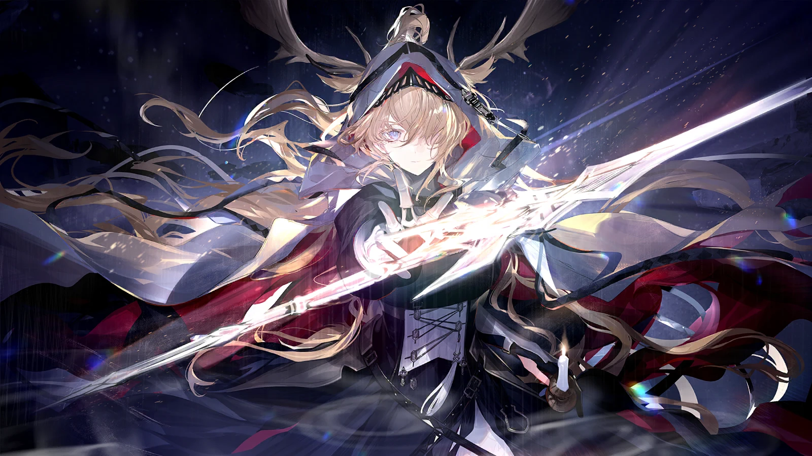
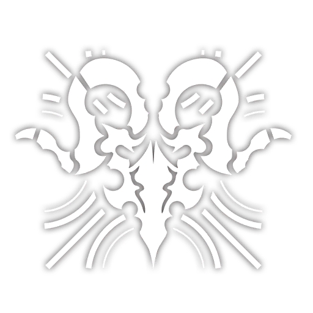

```html
<!DOCTYPE html>
<html lang="zh-Hant">
<head>
  <meta charset="UTF-8">
  <meta name="viewport" content="width=device-width, initial-scale=1">
  <title>薇薇安娜・燭騎士｜A6 雙面明信片</title>
  <style>
    :root {
      --ink: #242635;
      --night: #111321;
      --gold: #c7ae7d;
      --paper: #f5f0e6;
      --rule: #c7beac;
    }

    * {
      box-sizing: border-box;
    }

    html,
    body {
      margin: 0;
      padding: 0;
    }

    body {
      background: #dedbd5;
      color: var(--ink);
      font-family:
        "Noto Serif TC", "Songti TC", "PMingLiU", serif;
      -webkit-print-color-adjust: exact;
      print-color-adjust: exact;
    }

    .sheet {
      width: 148mm;
      margin: 10mm auto;
      display: flex;
      flex-direction: column;
      gap: 8mm;
    }

    .postcard {
      position: relative;
      width: 148mm;
      height: 105mm;
      flex: none;
      overflow: hidden;
      isolation: isolate;
      box-shadow: 0 2mm 6mm rgb(25 25 35 / 16%);
    }

    /* 正面：橫式 A6，主圖等比例滿版裁切，不拉伸。 */
    .front {
      background: var(--night);
      color: #fffaf0;
    }

    .hero {
      position: absolute;
      inset: 0;
      width: 100%;
      height: 100%;
      object-fit: cover;
      object-position: 50% 50%;
      z-index: -3;
    }

    /* 僅在上下文字區加遮罩，保留中央臉部與劍光的原始亮度。 */
    .front::before {
      content: "";
      position: absolute;
      inset: 0;
      z-index: -2;
      background: linear-gradient(
        to bottom,
        rgb(10 12 25 / 48%) 0%,
        rgb(10 12 25 / 8%) 19%,
        transparent 30%,
        transparent 62%,
        rgb(10 12 25 / 35%) 76%,
        rgb(10 12 25 / 88%) 100%
      );
    }

    .front::after {
      content: "";
      position: absolute;
      inset: 4mm;
      border: 0.2mm solid rgb(222 204 166 / 48%);
      pointer-events: none;
      z-index: -1;
    }

    .front-header {
      position: absolute;
      top: 7mm;
      left: 8mm;
      right: 8mm;
      display: flex;
      align-items: center;
      justify-content: space-between;
    }

    .faction {
      display: flex;
      align-items: center;
      gap: 2.5mm;
    }

    .faction img {
      width: 10mm;
      height: 10mm;
      object-fit: contain;
      opacity: 0.92;
    }

    .faction-text {
      display: flex;
      flex-direction: column;
      gap: 1mm;
      font-family: "Helvetica Neue", Arial, sans-serif;
    }

    .faction-text .en {
      font-size: 2.3mm;
      letter-spacing: 0.45mm;
    }

    .faction-text .zh {
      font-size: 2.3mm;
      letter-spacing: 0.8mm;
      color: #dfd1b5;
    }

    .arknights-logo {
      width: 20mm;
      height: auto;
      opacity: 0.93;
    }

    .front-title {
      position: absolute;
      left: 9mm;
      right: 9mm;
      bottom: 8mm;
      text-shadow: 0 0.5mm 2mm rgb(0 0 0 / 38%);
    }

    .front-kicker {
      display: flex;
      align-items: center;
      gap: 3mm;
      margin-bottom: 2mm;
      color: #e2cfaa;
      font-size: 2.5mm;
      letter-spacing: 0.5mm;
    }

    .front-kicker::before {
      content: "";
      width: 10mm;
      height: 0.25mm;
      background: var(--gold);
    }

    .front-title h1 {
      margin: 0;
      font-size: 7.5mm;
      font-weight: 500;
      line-height: 1.2;
      letter-spacing: 1.2mm;
    }

    .front-title .english-name {
      margin: 1.7mm 0 0;
      font-family: Georgia, "Times New Roman", serif;
      font-size: 3.4mm;
      line-height: 1.2;
      letter-spacing: 0.55mm;
    }

    .front-caption {
      display: flex;
      align-items: center;
      justify-content: space-between;
      gap: 3mm;
      margin-top: 3.8mm;
      padding-top: 2.2mm;
      border-top: 0.2mm solid rgb(222 204 166 / 48%);
      font-size: 2.2mm;
      line-height: 1.4;
      letter-spacing: 0.35mm;
      color: #ddd9d4;
    }

    .front-caption .event {
      color: #e8d7b7;
      white-space: nowrap;
    }

    /* 背面：暖白紙色、細線與小型徽章，不壓縮書寫空間。 */
    .back {
      background: var(--paper);
    }

    .back::before {
      content: "";
      position: absolute;
      top: 0;
      left: 0;
      right: 0;
      height: 1.2mm;
      background: var(--night);
    }

    .back-header {
      position: absolute;
      left: 9mm;
      top: 8mm;
      width: 95mm;
    }

    .back-header .eyebrow {
      margin: 0 0 1.7mm;
      color: #7e6d4e;
      font-family: "Helvetica Neue", Arial, sans-serif;
      font-size: 2.2mm;
      letter-spacing: 0.6mm;
    }

    .back-header h2 {
      margin: 0;
      font-size: 4.3mm;
      line-height: 1.4;
      font-weight: 500;
      letter-spacing: 0.35mm;
    }

    .back-header .subtitle {
      margin: 1mm 0 0;
      font-size: 2.2mm;
      color: #77716a;
      letter-spacing: 0.2mm;
    }

    .back-content {
      position: absolute;
      top: 30mm;
      left: 9mm;
      right: 9mm;
      bottom: 17mm;
      display: grid;
      grid-template-columns: 77mm 43mm;
      column-gap: 10mm;
    }

    .message {
      position: relative;
      padding-right: 3mm;
    }

    .quote {
      margin: 0;
      padding-left: 3mm;
      border-left: 0.5mm solid var(--gold);
    }

    .quote .english {
      display: block;
      font-family: Georgia, "Times New Roman", serif;
      font-size: 3mm;
      font-style: italic;
      line-height: 1.55;
      color: #353744;
    }

    .quote .chinese {
      display: block;
      margin-top: 1.5mm;
      font-size: 2.5mm;
      line-height: 1.6;
      color: #746b5e;
      letter-spacing: 0.2mm;
    }

    .message-label {
      margin: 6mm 0 1mm;
      color: #8d8372;
      font-size: 2mm;
      letter-spacing: 0.5mm;
    }

    .writing-line {
      width: 100%;
      height: 7mm;
      border-bottom: 0.18mm solid var(--rule);
    }

    .address {
      border-left: 0.2mm solid var(--rule);
      padding-left: 7mm;
    }

    .stamp {
      width: 18mm;
      height: 22mm;
      margin-left: auto;
      border: 0.25mm dashed #a39883;
      display: flex;
      flex-direction: column;
      justify-content: center;
      align-items: center;
      gap: 1.2mm;
    }

    .stamp img {
      width: 11mm;
      height: 11mm;
      object-fit: contain;
      filter: brightness(0);
      opacity: 0.48;
    }

    .stamp span {
      color: #968a74;
      font-family: Arial, sans-serif;
      font-size: 1.8mm;
      letter-spacing: 0.5mm;
    }

    .address-label {
      margin: 4mm 0 0;
      color: #8d8372;
      font-size: 2mm;
      letter-spacing: 0.5mm;
    }

    .address-line {
      height: 7mm;
      border-bottom: 0.18mm solid #b8ae9c;
    }

    .postal-code {
      display: flex;
      gap: 1.2mm;
      margin-top: 3mm;
    }

    .postal-code span {
      width: 3.6mm;
      height: 3.8mm;
      border: 0.18mm solid #b8ae9c;
    }

    .back-footer {
      position: absolute;
      left: 9mm;
      right: 9mm;
      bottom: 6mm;
      padding-top: 2mm;
      border-top: 0.2mm solid var(--rule);
      display: flex;
      align-items: center;
      justify-content: space-between;
      gap: 4mm;
    }

    .back-footer p {
      margin: 0;
      color: #766d5f;
      font-size: 2.1mm;
      line-height: 1.5;
      letter-spacing: 0.2mm;
    }

    .back-footer img {
      width: 15mm;
      height: auto;
      filter: brightness(0);
      opacity: 0.66;
    }

    @page {
      size: 168mm 238mm;
      margin: 10mm;
    }

    @media print {
      body {
        background: white;
      }

      .sheet {
        margin: 0;
      }

      .postcard {
        box-shadow: none;
        break-inside: avoid;
      }
    }
  </style>
</head>
<body>
  <main class="sheet" aria-label="A6 橫式明信片，正面與背面上下排列">

    <section class="postcard front" aria-label="明信片正面">
      

      <header class="front-header">
        <div class="faction">
          
          <div class="faction-text">
            <span class="en">LEITHANIEN</span>
            <span class="zh">萊塔尼亞</span>
          </div>
        </div>
        
      </header>

      <div class="front-title">
        <div class="front-kicker">燭騎士</div>
        <h1>薇薇安娜</h1>
        <p class="english-name">Viviana Droste</p>
        <div class="front-caption">
          <span>薇薇安娜‧德羅斯特</span>
          <span class="event">崔林特爾梅之金 · 活動 CG</span>
        </div>
      </div>
    </section>

    <section class="postcard back" aria-label="明信片背面">
      <header class="back-header">
        <p class="eyebrow">LEITHANIEN</p>
        <h2>燭騎士｜薇薇安娜‧德羅斯特</h2>
        <p class="subtitle">Viviana Droste</p>
      </header>

      <div class="back-content">
        <section class="message" aria-label="留言區">
          <blockquote class="quote">
            <span class="english">
              Let time rest upon this unlit night.
            </span>
            <span class="chinese">
              讓時間停在這個無燭的夜晚吧。
            </span>
          </blockquote>

          <p class="message-label">留言 / MESSAGE</p>
          <div class="writing-line"></div>
          <div class="writing-line"></div>
          <div class="writing-line"></div>
          <div class="writing-line"></div>
        </section>

        <section class="address" aria-label="郵票與收件地址">
          <div class="stamp" aria-label="郵票黏貼框">
            
            <span>郵票</span>
          </div>

          <p class="address-label">收件人 / TO</p>
          <div class="address-line"></div>
          <div class="address-line"></div>
          <div class="address-line"></div>

          <div class="postal-code" aria-label="郵遞區號">
            <span></span><span></span><span></span>
            <span></span><span></span><span></span>
          </div>
        </section>
      </div>

      <footer class="back-footer">
        <p>《明日方舟》｜崔林特爾梅之金 · 活動 CG</p>
        
      </footer>
    </section>

  </main>
</body>
</html>
```

- 採用 **148 × 105 mm 橫式 A6**，主圖等比例置中裁切，約保留原圖中央 1269 × 900 的範圍。
- 保留角色臉部、發光劍身與右下燭火；文字集中於下方，避免遮擋主要視覺。
- 正面以細金框與小型 Logo 點綴，僅在文字區加上漸層遮罩，凸顯原圖光影。
- 背面延續暖金與深藍色系，配置郵票框、地址線與留言區；台詞中文轉為繁體。