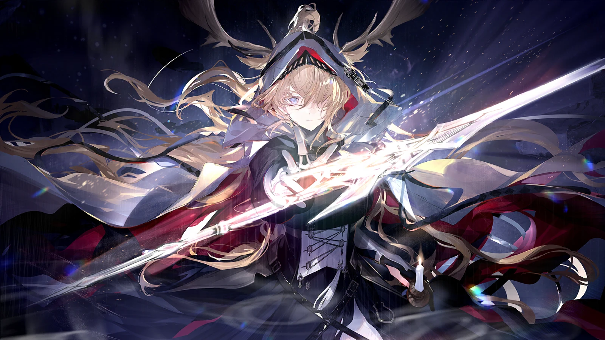
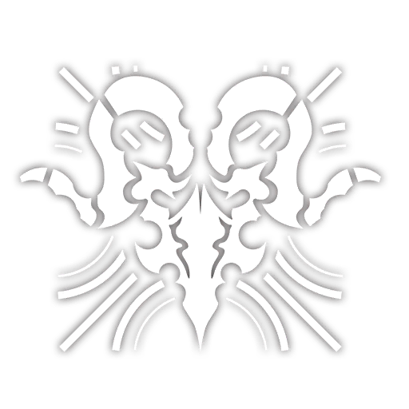

```html
<!doctype html>
<html lang="zh-Hant-TW">
<head>
  <meta charset="utf-8">
  <meta name="viewport" content="width=device-width, initial-scale=1">
  <title>燭騎士｜薇薇安娜‧德羅斯特</title>
  <style>
    :root {
      --gold: #e7cca0;
      --paper: #f7f2e8;
      --ink: #30283a;
      --muted: #67596b;
      --rule: #b6a695;
      --serif: "Noto Serif TC", "Songti TC", "PMingLiU", Georgia, serif;
      --sans: "Noto Sans TC", "PingFang TC", "Microsoft JhengHei", sans-serif;
    }

    * { box-sizing: border-box; }

    body {
      margin: 0;
      background: #22212b;
      font-family: var(--sans);
    }

    .sheet {
      display: grid;
      gap: 6mm;
      width: max-content;
      margin-inline: auto;
      padding: 8mm;
    }

    .card {
      position: relative;
      width: 148mm;
      height: 105mm;
      overflow: hidden;
      isolation: isolate;
      box-shadow: 0 2mm 7mm #0005;
    }

    /* 正面：保留原圖高度，以 A6 橫式比例裁去左右兩端。 */
    .front {
      background: #131426;
      color: #fff8eb;
    }

    .art, .shade {
      position: absolute;
      inset: 0;
      width: 100%;
      height: 100%;
    }

    .art {
      object-fit: cover;
      object-position: 52% 50%;
    }

    .shade {
      background:
        linear-gradient(0deg, #0c0c1a 0%, #0c0c1ae0 9%,
          #0c0c1a70 22%, transparent 37%),
        linear-gradient(180deg, #0c0c1a70, transparent 23%);
      pointer-events: none;
    }

    .front::after {
      content: "";
      position: absolute;
      inset: 3mm;
      border: .24mm solid #e7cca078;
      pointer-events: none;
    }

    .faction {
      position: absolute;
      top: 6mm;
      left: 7mm;
      display: flex;
      align-items: center;
      gap: 2mm;
      color: var(--gold);
      font-size: 2.8mm;
      letter-spacing: .25mm;
    }

    .faction img {
      width: 9mm;
      height: 9mm;
      object-fit: contain;
    }

    .faction span[lang="en"] {
      display: block;
      margin-top: .5mm;
      font: 2.35mm Georgia, serif;
      letter-spacing: .35mm;
      text-transform: uppercase;
    }

    .game-logo {
      position: absolute;
      top: 7mm;
      right: 8mm;
      width: 18mm;
      height: auto;
    }

    .front-title {
      position: absolute;
      bottom: 7mm;
      left: 8mm;
    }

    .epithet {
      display: flex;
      align-items: center;
      gap: 2mm;
      margin: 0 0 1.2mm;
      color: var(--gold);
      font-size: 2.8mm;
      letter-spacing: .85mm;
    }

    .epithet::before {
      content: "";
      width: 7mm;
      border-top: .25mm solid currentColor;
    }

    h1 {
      margin: 0;
      font: 700 6.8mm/1.12 var(--serif);
      letter-spacing: .25mm;
    }

    .roman-name {
      margin: 1.3mm 0 0;
      color: var(--gold);
      font: 3.2mm/1 Georgia, serif;
      letter-spacing: .65mm;
      text-transform: uppercase;
    }

    .credit {
      position: absolute;
      right: 8mm;
      bottom: 7mm;
      margin: 0;
      text-align: right;
      font-size: 2.7mm;
      line-height: 1.5;
      letter-spacing: .15mm;
    }

    .credit small {
      display: block;
      color: var(--gold);
      font-size: 2.25mm;
    }

    /* 背面：左側留言，右側貼票及填寫地址。 */
    .back {
      display: grid;
      grid-template-columns: 66mm 1fr;
      padding: 8mm;
      background: var(--paper);
      color: var(--ink);
    }

    .back::after {
      content: "";
      position: absolute;
      inset: 3mm;
      border: .24mm solid var(--rule);
      pointer-events: none;
    }

    .message {
      display: flex;
      flex-direction: column;
      padding-right: 6mm;
      border-right: .22mm solid var(--rule);
    }

    .postcard-heading {
      margin: 0;
      padding-bottom: 2.5mm;
      border-bottom: .3mm solid var(--rule);
      font: 700 4.4mm/1.15 var(--serif);
      letter-spacing: .4mm;
    }

    .postcard-heading span {
      margin-left: 2mm;
      color: var(--muted);
      font: 2.4mm Georgia, serif;
      letter-spacing: .5mm;
      text-transform: uppercase;
    }

    .quote {
      margin: 4mm 0 0;
      font: italic 3.5mm/1.35 Georgia, serif;
    }

    .quote p { margin: 0; }

    .quote .translation {
      margin-top: 1.3mm;
      color: var(--muted);
      font: 2.8mm/1.45 var(--serif);
    }

    .writing {
      flex: 1;
      display: flex;
      flex-direction: column;
      margin-top: 4mm;
    }

    .label {
      color: var(--muted);
      font-size: 2.5mm;
      letter-spacing: .4mm;
    }

    .writing .line {
      flex: 1;
      border-bottom: .2mm solid var(--rule);
    }

    .mail {
      position: relative;
      display: flex;
      flex-direction: column;
      padding-left: 6mm;
    }

    .stamp {
      align-self: flex-end;
      display: grid;
      place-content: center;
      justify-items: center;
      gap: 1mm;
      width: 22mm;
      height: 26mm;
      border: .3mm dashed #8b786d;
    }

    .stamp img {
      width: 12mm;
      height: 12mm;
      object-fit: contain;
      filter: brightness(0);
      opacity: .32;
    }

    .address {
      margin-top: auto;
    }

    .address-row {
      display: flex;
      align-items: end;
      gap: 2mm;
      height: 9mm;
    }

    .address-row:first-child { height: 7mm; }

    .address-row .label {
      flex: 0 0 12mm;
      padding-bottom: .6mm;
      white-space: nowrap;
    }

    .address-row .line {
      flex: 1;
      border-bottom: .22mm solid var(--rule);
    }

    .back-credit {
      margin: 4mm 0 0;
      color: var(--muted);
      text-align: right;
      font-size: 2.4mm;
      letter-spacing: .2mm;
    }

    @page {
      size: A4 portrait;
      margin: 10mm;
    }

    @media print {
      body { background: #fff; }

      .sheet {
        gap: 6mm;
        padding: 0;
      }

      .card {
        box-shadow: none;
        break-inside: avoid;
        -webkit-print-color-adjust: exact;
        print-color-adjust: exact;
      }
    }
  </style>
</head>
<body>
  <main class="sheet" aria-label="A6 明信片正反面">
    <section class="card front" aria-label="正面">
      
      <div class="shade" aria-hidden="true"></div>

      <div class="faction">
        
        <div>萊塔尼亞<span lang="en">Leithanien</span></div>
      </div>
      

      <header class="front-title">
        <p class="epithet">燭騎士</p>
        <h1>薇薇安娜‧德羅斯特</h1>
        <p class="roman-name" lang="en">Viviana Droste</p>
      </header>

      <p class="credit"><small>活動 CG</small>崔林特爾梅之金</p>
    </section>

    <section class="card back" aria-label="背面">
      <div class="message">
        <h2 class="postcard-heading">明信片<span lang="en">Postcard</span></h2>

        <blockquote class="quote">
          <p lang="en">“Let time rest upon this unlit night.”</p>
          <p class="translation">讓時間停在這個無燭的夜晚吧。</p>
        </blockquote>

        <div class="writing" aria-label="留言區">
          <span class="label">留言</span>
          <div class="line" aria-hidden="true"></div>
          <div class="line" aria-hidden="true"></div>
          <div class="line" aria-hidden="true"></div>
          <div class="line" aria-hidden="true"></div>
          <div class="line" aria-hidden="true"></div>
        </div>
      </div>

      <div class="mail">
        <div class="stamp">
          
          <span class="label">郵票</span>
        </div>

        <div class="address" aria-label="收件資訊">
          <div class="address-row"><span class="label">收件人</span><span class="line"></span></div>
          <div class="address-row"><span class="label">地址</span><span class="line"></span></div>
          <div class="address-row" aria-hidden="true"><span class="label"></span><span class="line"></span></div>
          <div class="address-row"><span class="label">郵遞區號</span><span class="line"></span></div>
        </div>

        <p class="back-credit">《明日方舟》｜崔林特爾梅之金</p>
      </div>
    </section>
  </main>
</body>
</html>
```

- 採用 148 × 105 mm 橫式滿版裁切，保留原圖全高，取景微向右移，讓臉部、斜向光芒與右下方的燭火都留在畫面內。
- 兩枚 Logo 放在上方角落，角色名與活動名沉在底部；只在邊緣加淡金細框與漸層，讓原圖的亮部維持焦點。
- 背面以暖象牙色搭配細線，將萊塔尼亞徽記縮成郵票框內的淡色圖騰，只選一句台詞，留出足夠的手寫空間。